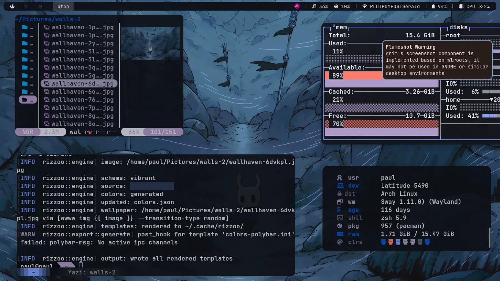

<div align="center">
  
   <br><br>
  
   <br><br>
  cross-platform Material 3 Expressive color generation
  <br>
  <sub>(pronounced: rihz-oo)</sub>
  <br><br>
  
  <a href="https://crates.io/crates/rizzoo">
    
  </a>
  
  <br><br>
  <a href="#showcase">Showcase</a>
  |
  <a href="#installation">Installation</a>
  |
  <a href="https://github.com/plgbrlism/rizzoo/wiki">Wiki</a>
  |
  <a href="#acknowledgements">Acknowledgements</a>
</div>

## Features

- **Material 3 Expressive** - palettes from any image, URL, or hex color
- **Source Color Picking** - choose the best candidate (`-P`, `-e`, `--open-picker`)
- **Scheme Blending** - mix two Material 3 styles at a custom ratio
- **Color Filters** - `hex_raw`, `rgb`, `hsl`, `lighten`, `darken`, `blend`, `harmonize`, `ensure_contrast`, and more, chainable with `:`
- **Wallpaper Wrappers** - Windows, macOS, X11, Wayland
- **Caching** - identical images never regenerate
- **Live Reload** - watch and re-render on change

## Showcase




## Usage

```sh
# from an image
rizzoo -i ~/Pictures/wall.jpg -r -o -p

# from a hex color
rizzoo -c "#7c3aed" -r -o

# from a URL
rizzoo -u "https://example.com/wall.jpg" -r -o

# first run? generate a config file
rizzoo --init
```

`-r` renders templates to cache, `-o` writes them to their configured output paths, `-p` previews the palette. A plain run prints nothing - add `-v` for progress and `-d` for debug detail.

Full flag list in the [CLI Reference](https://github.com/plgbrlism/rizzoo/wiki/CLI-Usage).

## Installation

```sh
cargo install rizzoo
```

From source instead:

```sh
git clone https://github.com/plgbrlism/rizzoo && cd rizzoo
sudo ./install.sh
```

Rust 1.86+ required when building from source.

## Configuration

`rizzoo` reads `~/.config/rizzoo/config.toml`. `rizzoo --init` writes a default one.

```toml
style = "tonal-spot"
mode  = "dark"

[wallpaper]
set     = false
command = "swaybg -i {{ image }} -m fill"

[alacritty]
template  = "colors-alacritty.toml"
output    = "~/.config/alacritty/colors.toml"
post_hook = "pkill -SIGUSR1 alacritty"
```

`post_hook` runs after the template is written. Add `enabled = false` to skip an entry. Full schema in [Configuration](https://github.com/plgbrlism/rizzoo/wiki/Configuration).

## Templates

Templates live in `~/.config/rizzoo/templates/`. Every Material role is a hex string:

```css
:root {
  --md-sys-color-primary: {{ primary }};
  --md-sys-color-surface: {{ surface }};
  --md-sys-color-error:   {{ error }};
}
```

Filter and chain with `:`:

```css
--border: {{ outline:darken(0.1):rgba(0.5) }};
```

Syntax and variables in the [Template Guide](https://github.com/plgbrlism/rizzoo/wiki/Templating); all 21 filters in the [Filter Reference](https://github.com/plgbrlism/rizzoo/wiki/Filters).

## Acknowledgements

- [matugen](https://github.com/InioX/matugen) - material theming inspiration
- [pywal](https://github.com/dylanaraps/pywal) - popularized wallpaper-based color theming
- [mcu-material-color](https://crates.io/crates/mcu-material-color) - rust port of google material color utilities
- [wallust](https://codeberg.org/explosion-mental/wallust.git)
- [hellwal](https://github.com/danihek/hellwal)
- [cwal](https://github.com/nitinbhat972/cwal)

## License

[MIT](LICENSE.md)
